# v3 tasks

Generated by `python3 tools/plan/plan.py index` from [tasks.toml](tasks.toml). Do not edit by hand.
Status: `landed`/`retired` in tasks.toml, then `plan.py ready`.

## Phase 0: Guard rails

| Id | Task | Lane | Size | Agent | Deps | Status |
|---|---|---|---|---|---|---|
| P0.0 | Scaffold tools/xtask and tools/probe (workspace members) | tooling | S | coordinator | – | landed `fadb0fef8` |
| P0.1 | xtask: size, debt, deps-check, timings | tooling | M | worker | P0.0 | landed `6cef256dc` |
| P0.2 | kontra-probe: playback contracts C1–C10 as a tool | tooling | L | worker | P0.0 | landed `acec4a059` (tools/probe retired later by f2b07ed02 (#1196)) |
| P0.3 | Probe fixtures: native-format instruments that reproduce the audited bugs | tooling | M | worker | P0.2 | landed `23acfb4fc` (tools/probe retired later by f2b07ed02 (#1196)) |
| P0.3b | Probe fixtures that reproduce the bugs: authored KSP (play_note offsets, ignore_event, UI load) | tooling | M | worker | P0.3 | landed `e4669871b` (tools/probe retired later by f2b07ed02 (#1196)) |
| P0.4 | Build profiles: fast profile, mold | tooling | S | worker | P0.1 | landed `cf7bab331` |
| P0.5 | v3 CI: plan checks, scope guard, push CI on v3 | tooling | S | coordinator | – | landed `b1522fb25` (v3.yml plan checks; closed by the coordinator without a PR) |
| P0.7 | xtask ci: one local gate, plus debt and size ratchets in CI | tooling | M | worker | P0.1 | landed `4847db907` |
| P0.6 | Gate G0: baseline on v3 | coordinator | S | coordinator | P0.1, P0.2, P0.3, P0.4 | landed `b6d0511fd` |
| P0.8 | One rustfmt pass over the workspace, then cargo fmt --check in CI | tooling | S | coordinator | P0.7 | retired |

## Phase 1: On-time start

| Id | Task | Lane | Size | Agent | Deps | Status |
|---|---|---|---|---|---|---|
| P1.1 | Reachable start range per zone (S.Mod, CC/RTC → start) | playback | M | worker | P0.3 | landed `a00805b3c` |
| P1.1b | Script play_note offsets join the zone start range | playback | M | worker | P1.1 | landed `16bc5ec9b` |
| P1.2 | Preload law: Kontakt DFD window (60 KB per channel + 2 × S.Mod), never shrink below it | playback | L | worker | P1.1b, P0.3b | landed `3189872d3` |
| P1.3 | No cold holds: late data is silence, the cursor keeps time | playback | M | worker | P1.2 | landed `26123eb21` |
| P1.4 | One start batch per callback instant; delete start runway and per-family cohorts | playback | M | worker | P1.3 | landed `a91e9b601` |
| P1.4b | Silent notes name their cause; fix Areia low keys and dense chords | playback | M | worker | P1.2 | retired |
| P1.5 | Gate G1: on-time start on real libraries | coordinator | S | coordinator | P1.4, P1.4b | retired |

## Phase 2: Scripts never stall notes

| Id | Task | Lane | Size | Agent | Deps | Status |
|---|---|---|---|---|---|---|
| P2.1 | Script UI writes go to a latest-value control store, not a queue | script | L | worker | P0.3b | retired |
| P2.2 | Delete behavior fuel and BehaviorOverload::Abort; KSP while limit only | script | M | worker | P2.1 | retired |
| P2.3 | Gate G2: Areia dense chords 64/64 | coordinator | S | coordinator | P2.2, P1.5 | retired |

## Phase 3: One script path without transport holds

| Id | Task | Lane | Size | Agent | Deps | Status |
|---|---|---|---|---|---|---|
| P3.1 | Spike: real-time-safe Luau allocator (mlua custom allocator or C-API shim) | script | S | spike | – | landed `f56e2767d` |
| P3.1b | Spike: keep mlua's API on an arena, and measure GC on the real UVI corpus | script | M | spike | P3.1 | landed `74334df48` |
| P3.1c | Spike: Lua GC on the audio thread for large heaps (Augmented Orchestra 360 MB, 15 ms stalls) | script | M | spike | P3.1b | landed `ef947fc9f` |
| P3.2 | UVI Lua inline on the audio thread; ScriptThread only as a feature fallback (draft) | script | L | worker | P3.1c, P2.2 | retired |
| P3.3 | Auto-align is latency compensation: report the slowest patch, delay the rest to it | playback | M | worker | P1.2 | landed `eff6687f1` |
| P3.4 | Gate G3: original complaints closed | coordinator | S | coordinator | P3.2, P3.3, P2.3 | retired |

## Phase 4: Base and model crates

| Id | Task | Lane | Size | Agent | Deps | Status |
|---|---|---|---|---|---|---|
| P4.0 | Scaffold every v3 crate (empty), workspace deps, target DAG | structure | M | worker | P0.1, P0.4 | landed `dda8eb144` |
| P4.1 | kontra-macros: crate and vectors! | structure | M | worker | P4.0 | landed `44463ccd2` |
| P4.2 | kontra-time and kontra-law (draft) | structure | M | worker | P4.0 | landed `74d18e7c3` |
| P4.3 | Move sampler-pool → crates/base/pool (kontra-pool) | structure | S | worker | P4.0, P2.1 | retired |
| P4.4 | Move sampler-simd (+ dsp/lanes.rs) → crates/base/simd (kontra-simd) | structure | S | worker | P4.3 | retired |
| P4.5 | #[derive(Params)] in kontra-macros | structure | M | worker | P4.1, P4.2 | retired |
| P4.6 | Parameter catalog: every DSP module's params in kontra-params (draft) | structure | L | worker | P4.5 | retired |
| P4.6a | Typed reverb control identities and shared law readback | structure | M | worker | – | landed `f8bc096c8` |
| P4.7 | Point the 5 parameter registries at the catalog; delete 4 (draft) | structure | L | worker | P4.6 | retired |
| P4.8 | kontra-events from src/sound/event.rs and the plain-data receiver wire types (draft) | structure | M | worker | P4.0, P4.2 | landed `999077e80` |
| P4.9 | kontra-ui-model from sampler-ui-ir + core widget/script_params + ControlStore (draft) | structure | M | worker | P4.0, P2.1, P4.7 | landed `cccc1992f` |
| P4.10 | Move sampler-ir → crates/model/ir (kontra-ir) | structure | S | worker | P4.0, P4.3 | retired |
| P4.11 | kontra-protocol: Command, Publications, Retired types | structure | S | worker | P4.0, P4.9 | retired |
| P4.12 | Gate G4: model crates in place | coordinator | S | coordinator | P4.4, P4.7, P4.8, P4.10, P4.11, P3.4 | retired |

## Phase 5: DSP families

| Id | Task | Lane | Size | Agent | Deps | Status |
|---|---|---|---|---|---|---|
| P5.0 | kontra-dsp-core (Module trait, shared blocks) + registry with legacy bridge | dsp | L | worker | P4.5, P4.12 | retired |
| P5.1 | DSP family: dynamics (Compressor, Limiter, Gate/Expander, Transient) | dsp | L | worker | P5.0 | landed `033e5af33` |
| P5.2 | DSP family: eq (Band, ParametricEq, GraphicEq) | dsp | M | worker | P5.1 | retired |
| P5.3a | DSP family: filter part A (Svf, BiquadCascade) | dsp | L | worker | P5.1 | retired |
| P5.3b | DSP family: filter part B (Ladder, Ar, Daft) | dsp | L | worker | P5.3a | retired |
| P5.3c | DSP family: filter part C (Formant, Comb, Phaser, shaper) | dsp | M | worker | P5.3a | landed `24051512b` |
| P5.4a | DSP family: delay part A (timemod → DelayLine, ModDelay, Tape, Diffuse) | dsp | L | worker | P5.1 | retired |
| P5.4b | DSP family: delay part B (Replika as DelayLine laws) | dsp | L | worker | P5.4a | retired |
| P5.5 | DSP family: reverb (Fdn, Convolver) | dsp | L | worker | P5.1 | retired |
| P5.6a | DSP family: drive part A (Shaper + named units as laws) | dsp | L | worker | P5.1 | landed `9bb88511a` (with P5.6c in #856) |
| P5.6b | DSP family: drive part B (Amp: tonestack → shaper → cab) | dsp | L | worker | P5.6a | retired |
| P5.6c | DSP family: drive part C (Crush: lofi, redux, machine) | dsp | M | worker | P5.6a | landed `ba6356fd9` |
| P5.7 | DSP family: spatial (Pan, Width, Rotator, SurroundPan, RingMod, StereoTune) | dsp | M | worker | P5.1 | retired |
| P5.8 | DSP family: modulators (Envelope, Lfo, Step, Follower, Glide) (draft) | dsp | L | worker | P5.1 | retired |
| P5.9 | Delete both Processor enums' legacy arms, lower.rs mapping, dsp.rs routing (draft) | dsp | L | worker | P5.2, P5.3b, P5.3c, P5.4b, P5.5, P5.6b, P5.6c, P5.7, P5.8 | retired |
| P5.10 | Gate G5: DSP A/B on reference libraries | coordinator | S | coordinator | P5.9 | retired |

## Phase 6: Engine crates

| Id | Task | Lane | Size | Agent | Deps | Status |
|---|---|---|---|---|---|---|
| P6.1a | kontra-stream: crate, Source trait, core stream/residency/head code moved (draft) | engine | L | worker | P5.10 | retired |
| P6.1b | kontra-stream: move the Kontakt stream service and drop uvi → kontakt (draft) | engine | L | worker | P6.1a | retired |
| P6.1c | Sample store: content-keyed, process-wide, packed preloads, deadline I/O (draft) | engine | L | worker | P6.1b | landed `403daaa58` |
| P6.2 | kontra-voice: source/resample/release/pitch moved; one chain runner (draft) | engine | L | worker | P6.1a | landed `d3d4c5d78` |
| P6.3a | kontra-vm: behavior/ops/schedule moved; HostApi trait (draft) | engine | L | worker | P5.10 | retired |
| P6.3b | on init on the VM; delete eval.rs and sampler-ksp luau/ (draft) | engine | L | worker | P6.3a | retired |
| P6.4a | kontra-engine: EventQueue + Timed<Work> + render loop at queue boundaries (draft) | engine | L | worker | P6.2, P6.3b | retired |
| P6.4b | kontra-engine: NoteLedger replaces held/consumed/closed tables and families-as-cohorts (draft) | engine | L | worker | P6.4a | retired |
| P6.4c | kontra-engine: Engine struct replaces Runtime's 109 fields; Stats derive (draft) | engine | L | worker | P6.4b | retired |
| P6.4d | Prepare bounded PGS storage for large instruments | engine | M | worker | – | landed `e293ba5ae` |
| P6.4e | Compile KSP escaped quotes without losing path backslashes | script | S | worker | – | landed `c685d1c2a` |
| P6.5 | Gate G6: engine crates | coordinator | S | coordinator | P6.1c, P6.4c | landed `90cf6f9f6` |

## Phase 7: Script and format crates

| Id | Task | Lane | Size | Agent | Deps | Status |
|---|---|---|---|---|---|---|
| P7.1 | kontra-ksp: move sampler-ksp; builtins! drives sema + lowering (draft) | script | L | worker | P6.5 | landed `e23b2dd5b` |
| P7.2 | kontra-lua: UVIScript surface from sampler-uvi/sampler-script (draft) | script | L | worker | P6.5 | landed `abbc0a6ba` |
| P7.3 | kontra-format: Format trait, formats! registry, map_effects!/map_mods!/map_zone! (draft) | format | M | worker | P6.5 | retired |
| P7.4 | format/kontakt: move sampler-kontakt; effects become map_effects! rows (draft) | format | L | worker | P7.3, P7.1 | landed `7d992daee` |
| P7.5 | format/uvi: move sampler-uvi; fx mapping as table rows (draft) | format | L | worker | P7.3, P7.2 | landed `394adee04` |
| P7.6 | format/sfz, format/native, ample, ikmpak moves (draft) | format | M | worker | P7.3 | landed `abba71e30` |
| P7.7 | Gate G7: surveys and parity | coordinator | S | coordinator | P7.4, P7.5, P7.6 | landed `c35de30d8` |

## Phase 8: App and plugin

| Id | Task | Lane | Size | Agent | Deps | Status |
|---|---|---|---|---|---|---|
| P8.1 | kontra-protocol: commands in, publications and retirements out | app | M | worker | P7.7 | landed `69911524f` (#962 (#959 was the plan change)) |
| P8.2 | kontra-host rack: parts, load off the audio thread, routing, master, panic | app | L | worker | P8.1 | landed `54366ba31` |
| P8.3 | app/library and app/align (draft) | app | M | worker | P8.1 | landed `7453214e2` |
| P8.4 | app/ui depends on protocol only | app | L | worker | P8.1 | landed `d57f8c31c` |
| P8.4b | NI Native UI (.nui) into the UI tree | app | L | worker | P8.4 | landed `823dba09a` (as crates/app/face (nui.rs, nui/layout.rs) over kontra-lua's nui module, not a crates/format/native-ui crate) |
| P8.5 | plugin/: the v3 plugin shell (KONTRA v3) beside v2 | app | M | worker | P8.2, P8.4 | landed `eb82af7d3` |
| P8.6 | Gate G8: v3 complete, v2 deleted, merge to main | coordinator | S | coordinator | P8.5, P8.4b | landed `4e55f6d33` |

## Dependency graph

```mermaid
flowchart LR
  subgraph ph0["0. Guard rails"]
    P0_0["P0.0"]
    P0_1["P0.1"]
    P0_2["P0.2"]
    P0_3["P0.3"]
    P0_3b["P0.3b"]
    P0_4["P0.4"]
    P0_5["P0.5"]
    P0_7["P0.7"]
    P0_6["P0.6"]
    P0_8["P0.8"]
  end
  subgraph ph1["1. On-time start"]
    P1_1["P1.1"]
    P1_1b["P1.1b"]
    P1_2["P1.2"]
    P1_3["P1.3"]
    P1_4["P1.4"]
    P1_4b["P1.4b"]
    P1_5["P1.5"]
  end
  subgraph ph2["2. Scripts never stall notes"]
    P2_1["P2.1"]
    P2_2["P2.2"]
    P2_3["P2.3"]
  end
  subgraph ph3["3. One script path without transport holds"]
    P3_1["P3.1"]
    P3_1b["P3.1b"]
    P3_1c["P3.1c"]
    P3_2["P3.2"]
    P3_3["P3.3"]
    P3_4["P3.4"]
  end
  subgraph ph4["4. Base and model crates"]
    P4_0["P4.0"]
    P4_1["P4.1"]
    P4_2["P4.2"]
    P4_3["P4.3"]
    P4_4["P4.4"]
    P4_5["P4.5"]
    P4_6["P4.6"]
    P4_6a["P4.6a"]
    P4_7["P4.7"]
    P4_8["P4.8"]
    P4_9["P4.9"]
    P4_10["P4.10"]
    P4_11["P4.11"]
    P4_12["P4.12"]
  end
  subgraph ph5["5. DSP families"]
    P5_0["P5.0"]
    P5_1["P5.1"]
    P5_2["P5.2"]
    P5_3a["P5.3a"]
    P5_3b["P5.3b"]
    P5_3c["P5.3c"]
    P5_4a["P5.4a"]
    P5_4b["P5.4b"]
    P5_5["P5.5"]
    P5_6a["P5.6a"]
    P5_6b["P5.6b"]
    P5_6c["P5.6c"]
    P5_7["P5.7"]
    P5_8["P5.8"]
    P5_9["P5.9"]
    P5_10["P5.10"]
  end
  subgraph ph6["6. Engine crates"]
    P6_1a["P6.1a"]
    P6_1b["P6.1b"]
    P6_1c["P6.1c"]
    P6_2["P6.2"]
    P6_3a["P6.3a"]
    P6_3b["P6.3b"]
    P6_4a["P6.4a"]
    P6_4b["P6.4b"]
    P6_4c["P6.4c"]
    P6_4d["P6.4d"]
    P6_4e["P6.4e"]
    P6_5["P6.5"]
  end
  subgraph ph7["7. Script and format crates"]
    P7_1["P7.1"]
    P7_2["P7.2"]
    P7_3["P7.3"]
    P7_4["P7.4"]
    P7_5["P7.5"]
    P7_6["P7.6"]
    P7_7["P7.7"]
  end
  subgraph ph8["8. App and plugin"]
    P8_1["P8.1"]
    P8_2["P8.2"]
    P8_3["P8.3"]
    P8_4["P8.4"]
    P8_4b["P8.4b"]
    P8_5["P8.5"]
    P8_6["P8.6"]
  end
  P0_0 --> P0_1
  P0_0 --> P0_2
  P0_2 --> P0_3
  P0_3 --> P0_3b
  P0_1 --> P0_4
  P0_1 --> P0_7
  P0_1 --> P0_6
  P0_2 --> P0_6
  P0_3 --> P0_6
  P0_4 --> P0_6
  P0_7 --> P0_8
  P0_3 --> P1_1
  P1_1 --> P1_1b
  P1_1b --> P1_2
  P0_3b --> P1_2
  P1_2 --> P1_3
  P1_3 --> P1_4
  P1_2 --> P1_4b
  P1_4 --> P1_5
  P1_4b --> P1_5
  P0_3b --> P2_1
  P2_1 --> P2_2
  P2_2 --> P2_3
  P1_5 --> P2_3
  P3_1 --> P3_1b
  P3_1b --> P3_1c
  P3_1c --> P3_2
  P2_2 --> P3_2
  P1_2 --> P3_3
  P3_2 --> P3_4
  P3_3 --> P3_4
  P2_3 --> P3_4
  P0_1 --> P4_0
  P0_4 --> P4_0
  P4_0 --> P4_1
  P4_0 --> P4_2
  P4_0 --> P4_3
  P2_1 --> P4_3
  P4_3 --> P4_4
  P4_1 --> P4_5
  P4_2 --> P4_5
  P4_5 --> P4_6
  P4_6 --> P4_7
  P4_0 --> P4_8
  P4_2 --> P4_8
  P4_0 --> P4_9
  P2_1 --> P4_9
  P4_7 --> P4_9
  P4_0 --> P4_10
  P4_3 --> P4_10
  P4_0 --> P4_11
  P4_9 --> P4_11
  P4_4 --> P4_12
  P4_7 --> P4_12
  P4_8 --> P4_12
  P4_10 --> P4_12
  P4_11 --> P4_12
  P3_4 --> P4_12
  P4_5 --> P5_0
  P4_12 --> P5_0
  P5_0 --> P5_1
  P5_1 --> P5_2
  P5_1 --> P5_3a
  P5_3a --> P5_3b
  P5_3a --> P5_3c
  P5_1 --> P5_4a
  P5_4a --> P5_4b
  P5_1 --> P5_5
  P5_1 --> P5_6a
  P5_6a --> P5_6b
  P5_6a --> P5_6c
  P5_1 --> P5_7
  P5_1 --> P5_8
  P5_2 --> P5_9
  P5_3b --> P5_9
  P5_3c --> P5_9
  P5_4b --> P5_9
  P5_5 --> P5_9
  P5_6b --> P5_9
  P5_6c --> P5_9
  P5_7 --> P5_9
  P5_8 --> P5_9
  P5_9 --> P5_10
  P5_10 --> P6_1a
  P6_1a --> P6_1b
  P6_1b --> P6_1c
  P6_1a --> P6_2
  P5_10 --> P6_3a
  P6_3a --> P6_3b
  P6_2 --> P6_4a
  P6_3b --> P6_4a
  P6_4a --> P6_4b
  P6_4b --> P6_4c
  P6_1c --> P6_5
  P6_4c --> P6_5
  P6_5 --> P7_1
  P6_5 --> P7_2
  P6_5 --> P7_3
  P7_3 --> P7_4
  P7_1 --> P7_4
  P7_3 --> P7_5
  P7_2 --> P7_5
  P7_3 --> P7_6
  P7_4 --> P7_7
  P7_5 --> P7_7
  P7_6 --> P7_7
  P7_7 --> P8_1
  P8_1 --> P8_2
  P8_1 --> P8_3
  P8_1 --> P8_4
  P8_4 --> P8_4b
  P8_2 --> P8_5
  P8_4 --> P8_5
  P8_5 --> P8_6
  P8_4b --> P8_6
```

