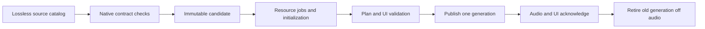

# Native contracts and an atomic library pipeline

Kontakt and Falcon/Workstation are the reference. Kontra v1 and v2 supply useful
implementation history, including mistakes shared by their tests. Correctness
requires a documented native rule or a versioned native capture. A matching
implementation, an audible note, or a completed importer is weaker evidence.

The [Kontakt native contract audit](kontakt-native-contract.md) and
[Falcon native contract audit](falcon-native-contract.md) link the primary manuals
and specify the next native probes. No new native plugin capture was run in this
audit. Existing receipts must retain their exact host, version and protocol.

## Keep the useful foundation

The current host already prepares parts off the audio thread, publishes
`Ready = (slot, generation, prepared part)`, rejects stale generations, and returns
retired data for destruction off audio. Script effects also carry slot, source
epoch and script-instance ownership. This is an audio-part handoff and a useful
partial transaction boundary. The view, interfaces, scripts and completion status
are published before audio installs the candidate; there is no shared audio/UI
acknowledgment. A failed load currently queues an empty part, clearing the previous
part. Replacement orphans held notes and retires the previous part immediately.
Changing those behaviors requires explicit contracts and tests.

Relevant sources: `src/plugin.rs` (`Ready`, `Shared`, `PartShared`, effects queues),
`src/sound/mod.rs` (`CoreLoader`, `LoadRequest`, `Loaded`),
`src/sound/v2.rs` (preparation/installation), and
`crates/sampler-ir` (partial source maps and admitted structure). Ordinary UVI
translation does not preserve a lossless element graph: zone source indices are
scan-only, and XML overrides use transient parser node IDs. See
`src/plugin.rs:2439`, `src/plugin.rs:3015`, `src/sound/v2.rs:2153`, and
`crates/sampler-uvi/src/lib.rs:797`.

## Proposed transaction

This is a proposed extension, not a claim that every stage is implemented.

1. Decode source structure without samples or callbacks. Retain unknown fields,
   physical slots, resource declarations and source coordinates. Attach source
   and dependency fingerprints. Never compact physical source identity into a
   different logical identity.
2. Check contracts with language-specific frontends. A future compatible Falcon
   Lua frontend must retain native semantics alongside KSP. The current Luau compiler check is an executable
   frontend check and does not establish Lua 5.1 equivalence. Keep declaration,
   binding, initialization and observed execution separate.
3. Build an immutable candidate containing source maps, admitted IR, callback
   programs, UI descriptors, dependency recipes and a staged report. Make every
   omission explicit. A compiler budget failure is an incomplete inspection,
   not evidence that the native library is defective.
4. Resolve resources with jobs tagged by candidate generation and stable resource
   identity. Prioritize admitted note starts and required UI dependencies. Route
   completion to the owning script scheduler; preserve order and cancellation.
   Native asynchronous APIs must complete through their documented callback path.
5. Initialize against a private candidate. Validate the actual native restore
   order, physical controls, asset references, routes, and model omissions.
   Required failures prevent commit. Optional unavailable assets remain named
   gaps; they do not become fabricated successful resources.
6. Publish one bundle: generation, audio part, UI model, source/report identity and
   ownership maps. Acknowledge it at the audio boundary before treating it as the
   active instrument. Commands from older generations are rejected visibly.
7. Keep resources required by old voices or callbacks alive until those owners
   release them. Retire and destroy off audio. Define cancellation for pending
   initialization and resource jobs explicitly.

Stable identity should use logical handles such as `(source generation, physical
program, source element/asset)` and a separate dense execution index. The narrowed
UVI impulse bug proved why an original asset identity cannot safely be used as an
index after note-zone compaction. Moving impulse decoding before compaction fixes
that case; typed handles would prevent the whole class of mismatch.

## Native rules already changed our decisions

UVI documents restored widget values before `onLoad`; the previous v2 initial
path reversed them, and two authored tests encoded that reversal. The corrected
visible-label regression follows the documented order. This is documented-rule
evidence, with native capture still pending.
[UVI event callbacks](https://lua.uvi.net/group___event_callbacks.html).

UVI documents asynchronous `loadSample` and script-thread completion, and
sample-accurate coroutine waits. An inline success fixture and a nil stub both
fall short of that contract. A new loader needs a resource-completion state
machine and a scheduler tied to sample time; replacing Lua syntax alone does
not satisfy it. [UVI asynchronous operations](https://lua.uvi.net/group___async.html),
[UVI time functions](https://lua.uvi.net/group___time.html).

Kontakt exposes asynchronous completion IDs and persistence callbacks. Candidate
state must distinguish an admitted request from its completion, preserve physical
script ownership, and restore values at the documented point. The detailed
rules and primary references are in the [Kontakt contract audit](kontakt-native-contract.md).

## Make inspection cheap by purpose

The offline inspector now has a compact path that retains construct status counts,
syntax outcomes, omissions and script source identities while omitting highlight tokens
and textual lowering records that the summary would discard. Full line inspection
and individual element identity remain available in full reports. Removing duplicate Kontakt compilation and a quadratic token
lookup improved one measured large source-only case; this is an internal
inspection measurement, not a native playback or whole-loader speed comparison.

The Falcon path now defers the extra binding translation unless parameter calls
need it, counts XML elements directly for compact reports, uses constant-time
membership for consumed nodes, and reuses already decoded bank XML. A bounded
large-program probe produced byte-identical compact results: the previous compact
path exceeded 120 seconds, the intermediate path took 33 seconds, and the
node-membership fix took 7.72 seconds. Storage contention confounded a later
measurement, so the decoded-input change has equivalence evidence without a
claimed speed ratio. These are local inspection receipts; native loader speed
and cold/warm playable time remain unmeasured.

Next, cache source-free structural metadata and fingerprints, keep protected code
and execution state in memory, reuse bank catalogs within a worker, and materialize
line-level lowering only when requested. Memoization must include the complete
binding environment and dependencies, not just script text. A fixed memory or
time budget must return a typed incomplete result.

Persistent caching currently refuses source-bearing Kontakt instruments,
script initialization states and retained typed faults. This intentionally sacrifices that cache path until
a safe source-free representation and exact rehydration protocol exist. Do not
call it a performance improvement without measuring cold and warm behavior.

## Prove the next implementation

| Gate | Receipt needed |
| --- | --- |
| Source preservation | All physical program/slot/element identities and unmodeled fields accounted for |
| Script semantics | Versioned native callback, restore-order, wait and asynchronous-completion traces |
| Atomic publication | Cancellation, stale edits, failed load, reload during held notes and resource completion after retirement |
| Audio | Matching native note/controller/state plans, finite output, onset/release and relevant DSP comparisons |
| UI | Matching native states, assets, fonts, coordinates and representative gestures, with pixel evidence where appropriate |
| Performance | Same machine/workload/state, separate cold/warm conditions, first playable time, first correct UI, peak memory and deadline misses |

The fastest acceptable path is the one that preserves these contracts. Until the
native probes pass, the report must retain unknowns rather than promoting a
source, binding or UI-model success to complete parity.
